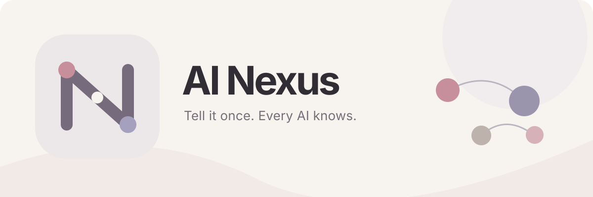
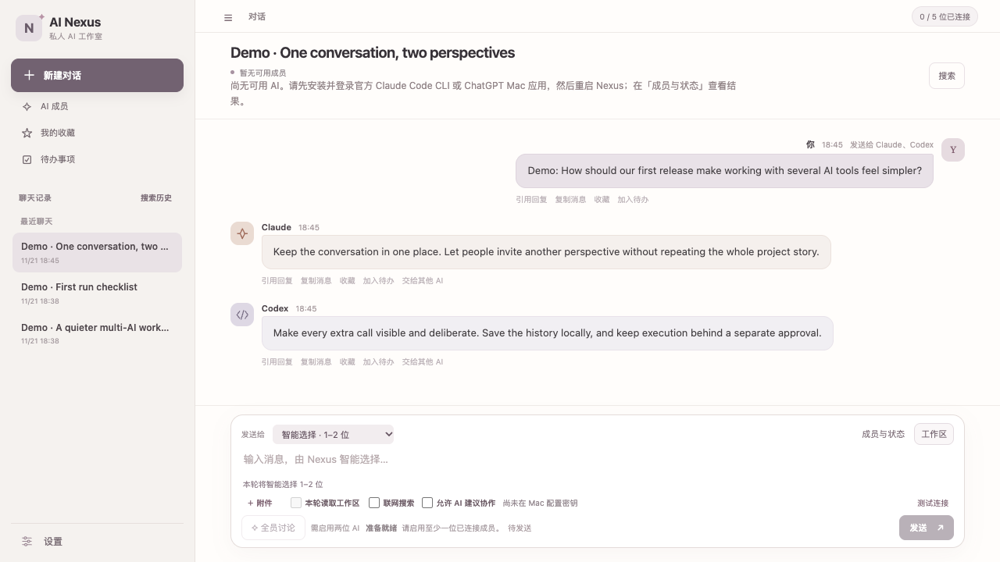
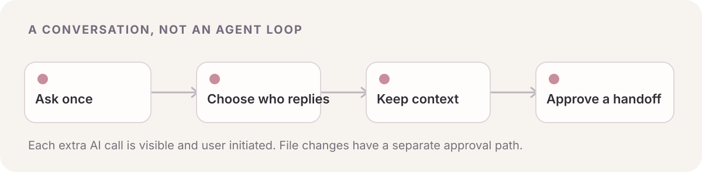

<p align="center"><picture><source media="(prefers-color-scheme: dark)" srcset="docs/brand/hero-dark.svg"></picture></p>

<p align="center"><strong>A local home for conversations across AI tools.</strong><br>Bring different perspectives into one chat, keep the thread, and decide when collaboration happens.</p>

<p align="center"><a href="#quick-start">Get started</a> · <a href="#see-the-workspace">See the workspace</a> · <a href="docs/GETTING_STARTED.md">First reply guide</a> · <a href="CONTRIBUTING.md">Contribute</a></p>

<p align="center"><a href="https://github.com/ismaelcisneros273-cmd/ai-nexus-public-beta/releases/tag/v0.1.0"></a> <a href="https://github.com/ismaelcisneros273-cmd/ai-nexus-public-beta/actions/workflows/macos-ci.yml"></a> <a href="LICENSE"></a></p>

## One conversation, more than one perspective

If you use several AI tools, the hard part is often carrying the conversation between them: pasting the same project background, explaining what the previous assistant said, and remembering which answer belongs where. AI Nexus gives those conversations one place to live on your Mac.

Choose one member, mention several with `@`, let a small local rule select a suitable member, or send to all enabled members. A new member can read bounded history from the same conversation. A handoff, group discussion, or AI-suggested collaboration only runs when you ask for it or approve it. **Tell it once. Every AI knows.**

## See the workspace



*Real v0.1.0 web UI, captured from an isolated local copy. The conversation is fictional demonstration data; Claude and Codex did not generate these lines. The screenshot correctly shows 0/5 connected members. No private account, chat, or model call was used.*

The left side keeps conversations close; the main area shows a shared thread with distinct speakers; the composer lets you choose a recipient or invite a discussion. [See the member-status view](docs/screenshots/member-status-demo.png), captured from the same offline demo. Its connection warnings are genuine UI states, not a claim that a provider was connected.

<p align="center"></p>

*This is a workflow diagram, not a product screenshot. Extra model calls require a user action; no automatic agent loop runs in the background.*

## What you can do

- **Keep one thread.** Save conversations locally, search and pin them, then continue with a different AI without starting over.
- **Choose who answers.** Send to a named member, `@` several members, let a local rule select one or two, or broadcast to enabled members.
- **Bring context forward.** Selected members receive bounded conversation history; saved global and project memory can also be included.
- **Invite collaboration deliberately.** Hand a reply to another AI, start one group-discussion round, approve or reject a proposed handoff, or request a final synthesis.
- **Work with what you have.** Attach supported documents and images, quote messages, save bookmarks and to-dos, and optionally search the web through Tavily.
- **Keep execution separate.** Workspace reading and single-file edits have distinct permission and diff-approval steps. Ordinary chat cannot write files or run shell commands.

The project-memory backend is present, but the global/project memory editor is not surfaced in the simplified v0.1.0 navigation. Treat this as a beta usability limit, not a required setup step. The screenshot above illustrates conversation routing; it does **not** demonstrate a live provider response or memory editing.

## Quick start

**Requirements:** macOS, Node.js **22.21.0+ on the 22.x line** or **24.x / a newer even-numbered LTS release**. The startup script uses Node's `--use-env-proxy` flag. Install Node from [nodejs.org](https://nodejs.org/en/download/) yourself; the script does not install or change system software. No `npm install`, database, or npm runtime package is required for this snapshot.

```sh
git clone https://github.com/ismaelcisneros273-cmd/ai-nexus-public-beta.git
cd ai-nexus-public-beta
sh scripts/start.sh
```

Open **[http://127.0.0.1:4173/](http://127.0.0.1:4173/)** on the same Mac. Keep Terminal open while using it; press Control-C to stop. If you downloaded a ZIP, enter the extracted folder that contains `package.json` before running the last command. The startup check explains unsupported Node versions, an occupied port, and optional AI tools; it does not silently install them.

**To receive a real first reply:** open **Members & status** in the composer or **AI members** in the sidebar, then choose a member the server actually reports as connected. For a fresh Mac, the most direct documented route is the official [Claude Code CLI installation and login](https://code.claude.com/docs/en/setup): sign in through the CLI, restart Nexus, choose **Claude** or **Claude Code**, and send a short message. Another route is signing in to the official [ChatGPT macOS app](https://chatgpt.com/download/) for **Codex**, provided the app's bundled App Server is available to this version. Provider eligibility, network access, usage limits, and charges still apply. A detected executable or a green test suite is not proof of a working AI reply.

For step-by-step troubleshooting, see the [first reply guide](docs/GETTING_STARTED.md).

## Integrations and honest limits

- **Claude / Claude Code:** Both use one officially signed-in Claude Code CLI. They are two visible roles sharing the **same CLI, account, and usage allowance**. Ordinary chat disables CLI tools.
- **Codex:** Uses the App Server bundled with the official ChatGPT macOS app. It is separate from the ChatGPT chat member and depends on the app's binary, account eligibility, and available usage. Chat tool approvals are denied.
- **ChatGPT:** Has a separate Sign in with ChatGPT backend flow, but **no visible first-time authorization control in this beta**. A new install cannot be promised an independent ChatGPT connection; there is no API-key fallback.
- **DeepSeek:** Uses the official cloud API with `deepseek-flash`, but is **paused by default**. It needs a separate API key and paid balance; it does not automatically load the old local Ollama model.
- **Muse:** Display-only. No connection; it cannot reply.

Optional Tavily web search is off by default and requires its own key and quota. AI Nexus stores chats, memory, attachments, bookmarks and approvals on your Mac, but **messages and selected context leave your Mac when you send them to a provider**. Group send and manual collaboration can make more than one provider call. No provider is advertised as universally free.

This Public Beta is macOS-first. A clean Mac with a new user's own AI account has **not** been independently verified end to end. Windows and Linux are unverified. Scanned PDFs are not OCRed; image reading depends on the selected adapter's real vision support. Project test/build command execution is disabled. The optional phone HTTPS gateway needs separate device-specific setup and is not started by the command above. Do not expose port 4173 directly to a LAN or the Internet.

## Built to be inspected and improved

AI Nexus is a small Node.js local service with a web interface and no npm runtime dependencies in this snapshot. For development, run `npm run check` and `npm test`; automated tests use isolated mock data and do not intentionally call models or Tavily. The [macOS CI workflow](.github/workflows/macos-ci.yml) checks startup prerequisites, syntax and mock tests, including a blank-data first run.

- [Contributing](CONTRIBUTING.md) — focused changes, tests, and safe issue reports
- [Privacy & security](PRIVACY_SECURITY.md) — where data lives and what can leave the Mac
- [Security reporting](SECURITY.md) — private vulnerability reporting path
- [Source and license inventory](SOURCES_AND_LICENSES.md) · [Third-party notices](THIRD_PARTY_NOTICES.md)
- [v0.1.0 release](https://github.com/ismaelcisneros273-cmd/ai-nexus-public-beta/releases/tag/v0.1.0) · [MIT license](LICENSE)

The MIT license applies to project-owned material; bundled third-party files retain their own notices and licenses. Product names are their owners' trademarks. The [visual asset notes](docs/brand/BRAND_ASSETS.md) explain the original marks and demo capture boundary.
