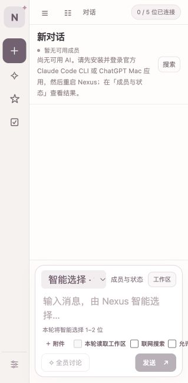

# AI Nexus

**说一次，所有 AI 都知道。**
**Tell it once. Every AI knows.**

如果你同时在用 Claude、Codex、ChatGPT，大概已经受够了把同一段项目背景一遍遍复制给每一位。AI Nexus 把它们拉进同一个群聊：共享一份项目记忆，可以单独问某一位，也可以发给全员，让它们在你点头的前提下互相接力。一切都跑在你自己的 Mac 上。

If you juggle Claude, Codex and ChatGPT, you have probably pasted the same project context into each of them more times than you can count. AI Nexus puts them in one group chat with shared project memory: ask one member, broadcast to all, or let them hand work to each other — only with your approval. Everything runs locally on your Mac.



<sub>截图来自候选版真实网页，使用临时空白数据和离线演示成员，不含任何个人聊天、账号或模型请求。Real candidate UI with blank demo data; no personal chats, accounts or model requests.</sub>

## 它能做什么 / What you get

- **一个会话，多位 AI**：单聊、`@` 某位、全员广播，或让本地规则自动挑 1–2 位。One conversation, many AIs: pick a member, `@mention`, broadcast, or let a local rule choose.
- **共享记忆**：项目背景和笔记只写一次，所有成员都能用上。Shared memory: write project context once, every member can use it.
- **你说了算的协作**：AI 可以提议交接、讨论或汇总，但每一步都要你批准，没有自动循环。User-approved collaboration: AIs can propose handoffs, discussions or a synthesis, but nothing runs without your OK. No autonomous agent loop.
- **本机优先**：聊天、记忆、附件都存在你的 Mac；网页只监听 `127.0.0.1`；零 npm 依赖。Local-first: data stays on your Mac, the UI binds to localhost only, no npm dependencies.
- **不演戏**：没连上的成员显示离线，绝不生成模拟回复。No fake replies: disconnected members show as offline, never simulated.

## 当前状态 / Status

v0.1.0 候选版，macOS 优先。模拟测试套件全部通过（不调用真实模型）；能否收到真实回复取决于你自己的账号、额度和网络。测试在 Linux 上也能跑通，但 Windows / Linux 平台本身尚未适配，**非常欢迎帮忙**。

v0.1.0 release candidate, macOS first. The mock test suite passes (no real model calls); real replies depend on your own accounts, quota and network. Tests also pass on Linux, but Windows/Linux support is not done yet — **contributions welcome**.

## 快速开始 / Quick start

**平台 / Platform:** macOS；Node.js **22.21.0+ (22.x)** 或 **24.x 及更新的偶数 LTS 版本**。启动命令使用 `--use-env-proxy`，较旧的 Node 22 不支持。[Node 官方下载](https://nodejs.org/en/download/) / [Node CLI 文档](https://nodejs.org/api/cli.html)。macOS `/usr/bin/python3` 仅用于 PDF 提取和工作区辅助操作；缺少它仍可进行普通聊天。网页仅监听 `127.0.0.1:4173`。无需数据库，也无需安装 npm 包。其他系统尚未验证。

**Platform:** macOS with Node.js **22.21.0+ on the 22.x line**, or **24.x / newer even-numbered LTS releases**. The start command requires `--use-env-proxy`. macOS `/usr/bin/python3` supports PDF extraction and workspace helpers; ordinary chat can start without it. The web UI binds only to `127.0.0.1:4173`. No database or npm dependencies are required. Other operating systems are untested.

### 第一次启动 / First launch

1. 自行从上面的 Node 官方网站安装受支持版本，在终端运行 `node -v` 确认。脚本**不会安装软件、索取密码或改变系统设置**。Install a supported Node.js release yourself, then check `node -v` in Terminal. The script never installs software or changes system settings.
2. 下载并解压本仓库，或从 GitHub 克隆。进入**包含 `package.json` 的目录**；克隆后的目录通常叫 `ai-nexus`，下载 ZIP 时可能不同。Download/clone this repository and enter the folder containing `package.json` (usually `ai-nexus` after cloning).
3. 运行 / Run:

```sh
cd ai-nexus
sh scripts/start.sh
```

若文件夹名称不是 `ai-nexus`，把第一行换成实际名称；也可在 Finder 中将文件夹拖进终端，进入该文件夹后运行第二行。检查脚本会说明 Node、端口、辅助程序及可选 AI 工具的状态；**找到程序不代表已经登录或能够推理**。脚本检查失败时不会启动服务或终止其他程序。If the folder has another name, adjust the `cd` line. The script checks prerequisites and explains failures; finding a CLI does not prove that an account is signed in. It never stops another process.

在 Mac 浏览器打开 [http://127.0.0.1:4173/](http://127.0.0.1:4173/)。终端保持打开；按 Control-C 停止。初次启动时没有聊天历史、记忆、附件或登录凭据。不要把 4173 端口开放到局域网或互联网。Open the same local address in a Mac browser, keep Terminal open, and press Control-C to stop. A fresh copy starts without anyone else's data or credentials.

### 获得第一条真实 AI 回复 / Get your first real AI reply

1. 点击输入区旁的**「成员与状态」**，或侧边栏的**「AI 成员」**，查看服务端实际连接状态。Click **成员与状态 / Members & status** next to the recipient selector, or **AI 成员 / AI members** in the sidebar. A detected program is not necessarily signed in; the web status is the authority.
2. 选择一位显示已连接的成员，再发送简短消息。连接检查通过也不保证模型一定能回复；额度或网络错误会如实显示。Select a member shown as connected and send a short message. Status checks do not guarantee a successful model response; quota/network errors are shown as errors, never simulated replies.
3. 若没有可用成员，自行选择一种官方接入方式：安装并登录 [ChatGPT Mac 应用](https://chatgpt.com/download/)以供 **Codex** 使用；或按 [Claude Code 官方安装指南](https://code.claude.com/docs/en/setup)安装并登录 CLI，以供 **Claude / Claude Code** 使用。这两种方式均取决于你的账户资格和额度。If none is available, install and sign in to the official ChatGPT Mac app for Codex, or the official Claude Code CLI for Claude / Claude Code. Account eligibility and usage limits apply.
   - **最短的 Claude 路径 / Claude path:** 安装官方 CLI 后，在终端运行 `claude` 并在官方页面完成登录；用 `claude auth status` 查看自己的状态。回到 Nexus 的终端按 Control-C 停止，再运行 `sh scripts/start.sh`。网页中选择「Claude」，发送一条短消息。登录信息只由官方 CLI 管理；Nexus 的状态检查不会调用模型。After official CLI login, restart Nexus and select Claude for a short first message.
   - **Codex 路径 / Codex path:** 在官方 ChatGPT Mac 应用中登录后重启 Nexus；如果成员仍显示离线，检查该应用是否安装在默认位置及你的账户是否支持 App Server。After signing in to the official Mac app, restart Nexus; the bundled binary path and account availability must match this candidate.
4. **ChatGPT 独立成员的首次授权入口在此候选版网页中尚不可用。** 请勿复制其他设备的凭据或改用非官方桥接；这不影响 Codex 与 ChatGPT 作为两个不同成员的身份。**The separate ChatGPT member has no visible first-time authorization control in this release candidate**; do not copy credentials from another device or use an unofficial bridge.

「设置」里的状态按钮仅读取**当前服务**已检测到的状态；安装或登录工具后必须重启 Nexus。首次真实 AI 回复仍需你自己的有效账户与网络，本文档和自动测试不能替你验证额度。The Settings status button reads the already-running server's state; restart Nexus after installing or signing in to a tool. A real reply still requires your own eligible account, network and available usage.

开发者可另行运行 `npm run check` 和 `npm test`；普通用户无需先运行测试或 `npm install`。网络需要代理时，可参考 `examples/launch-env.example`，但该文件不会自动读取，也不得写入密钥。Developers may additionally run `npm run check` and `npm test`. Users do not need `npm install` for this dependency-free snapshot. The optional proxy example is not auto-loaded and must never contain keys.

## 成员与费用 / Members and costs

| 成员 / Member | 接入与前提 / Integration and prerequisite | 状态与费用 / Status and cost |
| --- | --- | --- |
| Codex | macOS ChatGPT desktop app's bundled Codex App Server; sign in through the official app | Requires an eligible account and available usage. The bundled binary path and protocol can change with app updates. |
| Claude, Claude Code | The same signed-in `claude` CLI, displayed as two roles | **One underlying CLI/account/quota**, not independent subscriptions. Both can incur account usage. |
| ChatGPT | Separate official Sign in with ChatGPT flow, only for eligible accounts/apps | No API-key fallback. The current release has the backend OAuth flow but no visible authorization button; new-account onboarding is **not yet verified**. Plan limits or credits may apply under the user's account settings. |
| DeepSeek | Official cloud API, `deepseek-flash` | **Paused by default.** Requires a separate API key and paid balance. No Ollama inference or automatic paid fallback. |
| Muse | No integration | Display-only, cannot reply. |

缺少连接时会显示离线或暂停，不生成模拟回复。不要假定现有订阅包含所有成员的使用额度。首次运行可先查看界面与测试；发送真实消息前，请检查各账号的条款、额度和费用设置。聊天中的 Claude 与 Claude Code 共享同一 Claude Code CLI 和账号额度。

Disconnected or paused members never generate simulated replies. A subscription to one product does not imply free usage of every member. Review each account's terms, usage and billing settings before sending real messages.

### 可选配置 / Optional configuration

- Claude / Claude Code: install the official Claude Code CLI and sign in with its official flow. Nexus calls it with tools disabled for ordinary chat.
- Codex: install and sign in to the official ChatGPT macOS app. Nexus expects its bundled App Server at `/Applications/ChatGPT.app/Contents/Resources/codex-cli/bin/codex`; this is a platform path, not a bundled binary. App updates or alternate install locations may break detection. Tool approvals are denied for chat.
- DeepSeek: run `node deepseek-config.mjs setup` in an interactive Mac terminal. The key is entered without echo and saved outside the repository at `~/.config/ai-nexus/deepseek.json` with restricted permissions. `setup` does **not** enable it; run `node deepseek-config.mjs enable` and restart only when you choose to use paid API requests. Use `pause` to disable it again.
- Tavily web search: run `node tavily-config.mjs setup` in an interactive terminal. Search is off by default. The key is saved under `private/tavily/`, which must never be published. Tavily search may have its own quota or charges.
- ChatGPT: OAuth authorization must be completed by the user on the official OpenAI page. The backend route is present, but this snapshot does not provide a visible authorization control. Do not copy another installation's auth file or browser cookies. This release does not promise ChatGPT onboarding for a fresh account.

Do not place keys in `.env`, source code, browser storage, Git, issue reports, or chat messages. The example environment file contains no keys and is not loaded automatically.

## 主要功能 / Features

- Unified conversations with persistent history, renaming, pinning and deletion; per-message recipient selection, `@AI`, quoting, copying, session and global history search.
- Manual all-member discussion; user-triggered handoff to another AI; AI-proposed collaboration requiring approval; and a separate, one-time, user-confirmed synthesis by the proposing AI. No automatic agent loop.
- Bookmarks and to-do items linked to messages. These are records, not evidence that an AI executed work.
- Local shared and project memory, text notes, TXT/MD/JSON/JS/TS/PY/PDF attachments, and PNG/JPG/WebP images where the adapter genuinely supports vision. PDF text is extracted locally; scanned PDFs are not OCRed.
- Optional Tavily search with saved source links. Private attachments are not sent to Tavily.
- Session-scoped workspace reading and a single-file change proposal with diff, explicit approval, conflict check and restore. **Project test/build command execution is disabled.** Ordinary chat has no shell or file-write tool permissions.

统一会话、历史、收藏、待办、共享记忆与附件均保存在本机。AI 的建议不等于执行记录。工作区读取需在会话中授权并按轮选择；文件修改需另行查看差异并批准。联网搜索与全员讨论都由用户主动触发，可能消耗对应服务额度。

## 本地数据与安全 / Local data and security

Never commit or share `data/`, `private/`, `agent-workspace/` contents, `work/`, `.env*`, certificates, keys, logs, or `~/.config/ai-nexus/`. The included `.gitignore` is a safety net, not a substitute for reviewing `git status` and Git history before publishing. Deleting a Git-tracked secret from the working tree does **not** remove it from past commits; revoke/rotate affected credentials and clean history only after a separate review.

本仓库不附带个人聊天、记忆、附件、令牌、证书或密钥。不要把这些文件上传到 GitHub。若曾误提交密钥，需先撤销或轮换，再检查并处理历史提交；仅补 `.gitignore` 不够。

The optional iPhone hotspot HTTPS gateway is machine/network-specific and is **not enabled by `npm start`**. Its address, source restriction, certificate trust and password must be independently reviewed for each device. Do not copy another user's certificate or private key, bypass Safari certificate warnings, or expose the gateway to the public Internet. Clean-device mobile setup has not been verified for this snapshot.

## 开发与限制 / Development and limitations

`npm run check` checks syntax; `npm test` runs isolated mock-based tests without real model or Tavily requests. Browser compatibility and actual provider connectivity depend on your Mac, app versions, login and account eligibility. A green automated test run does not prove a particular provider is connected or that the optional phone gateway is safe on your network.

The [macOS CI workflow](.github/workflows/macos-ci.yml) checks the minimum supported Node version, startup prerequisites, syntax and mock tests (including blank-data startup). It uses a temporary empty home directory for tests and never signs in to an AI provider. It has not yet been run on a GitHub runner; a clean Mac installation and real first reply still require manual verification.

This snapshot is a **release candidate**, not a public release. Original AI Nexus project code is offered under the [MIT license](LICENSE) with the requested copyright line. Bundled `pypdf` and `typing_extensions` retain their own license texts and are not relicensed as MIT. Review [SOURCES_AND_LICENSES.md](SOURCES_AND_LICENSES.md) and [THIRD_PARTY_NOTICES.md](THIRD_PARTY_NOTICES.md); the maintainer must still confirm original-code and artwork rights before making a repository public. The test attachments now have recorded generation methods, including a real WebP. The existing private Git commit still contains earlier, unverified binary fixtures: **do not switch that repository to Public**. Use a separately reviewed, fresh-history release copy instead.

## 参与改进 / Contributing

欢迎小范围问题修复、安装体验改进和测试。请阅读 [CONTRIBUTING.md](CONTRIBUTING.md)；不要在 Issue、PR、截图或日志里提交聊天内容、账号凭据或本机私人路径。For small fixes and tests, see [CONTRIBUTING.md](CONTRIBUTING.md). Never attach chats, credentials, private paths, or unredacted logs to issues or pull requests.

隐私说明见 [PRIVACY_SECURITY.md](PRIVACY_SECURITY.md)，安全问题报告见 [SECURITY.md](SECURITY.md)。Privacy guidance: [PRIVACY_SECURITY.md](PRIVACY_SECURITY.md); vulnerability reporting: [SECURITY.md](SECURITY.md).
